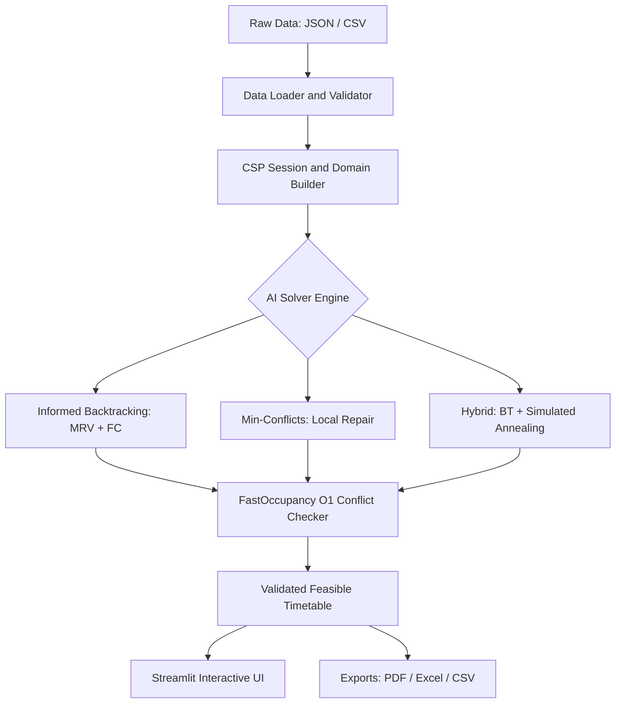

#  AI-Based University Timetable Scheduler

[](https://www.python.org/)
[](https://streamlit.io/)
[](tests/test_core.py)
[]()

An AI-powered academic course timetable generator that formulates scheduling as a **Constraint Satisfaction Problem (CSP)** with multi-objective optimization. Features five AI algorithms, solvability pre-validation, interactive Streamlit UI, conflict-checked manual editor, and multi-format exports (PDF, Excel, CSV).

---

##  System Architecture & Data Flow



### Core Design Principles
* **Decoupled Architecture**: `core/` is 100% pure Python with zero UI dependencies.
* **O(1) Collision Tracking**: `FastOccupancy` uses spatial-temporal hash counters to detect room, teacher, and class clashes in $O(1)$ time instead of $O(N^2)$ loops.
* **Solvability Pre-Check**: Mathematically verifies room capacity, total weekly hours, and faculty workloads before solving to guarantee problems are feasible.

---

##  Constraints Modeled

### Hard Constraints (H1 – H9) — Zero Violations Allowed
Any timetable with hard violations ($H > 0$) is invalid.

| Code | Constraint Name | Description |
| :---: | :--- | :--- |
| **H1** | **Teacher Clash** | A faculty member cannot teach two classes simultaneously. |
| **H2** | **Class Clash** | A student batch cannot attend two sessions simultaneously. |
| **H3** | **Room Clash** | A physical room cannot host two sessions simultaneously. |
| **H4** | **Room Capacity** | Room capacity must be greater than or equal to class student strength. |
| **H5** | **Room Type Match** | Lab sessions must be in labs; theory lectures in standard classrooms. |
| **H6** | **Teacher Availability** | Sessions cannot be scheduled during a teacher's unavailable hours. |
| **H7** | **Contact Hours** | Every subject receives exactly its required weekly contact hours. |
| **H8** | **Teacher Workload** | Faculty weekly hours cannot exceed their maximum weekly load. |
| **H9** | **Lunch Break** | No sessions may be scheduled during a class batch's lunch period. |

### Soft Constraints (S1 – S5) — Quality Optimization
Penalties are minimized using configurable weights ($w_k$).

| Code | Constraint Name | Weight | Objective |
| :---: | :--- | :---: | :--- |
| **S1** | **Student Idle Gaps** | 2.0 | Minimizes free waiting periods between student lectures. |
| **S2** | **Subject Dispersion** | 2.0 | Avoids multiple theory lectures of the same subject on the same day. |
| **S3** | **Lab Continuity** | 3.0 | Ensures multi-hour laboratory sessions are contiguous. |
| **S4** | **Teacher Preferences** | 1.0 | Respects faculty time preferences (avoid periods). |
| **S5** | **Teacher Load Smoothing** | 2.0 | Prevents scheduling faculty for more than 2 consecutive hours. |

$$\text{Global Cost} = 1000 \times \sum_{k=1}^9 \text{violations}(H_k) + \sum_{m=1}^5 w_m \times \text{violations}(S_m)$$

---

##  AI Solvers & Heuristics

1. **Informed CSP Backtracking (`core/backtracking.py`)**:
   - **MRV (Minimum Remaining Values)**: Fails-first variable ordering based on smallest remaining domain.
   - **Degree Heuristic**: Breaks ties using the highest constraint degree with unassigned sessions.
   - **Least Constraining Value (LCV)**: Orders values to rule out fewest choices for neighbors.
   - **Forward Checking (FC)**: Prunes conflicting values from neighbor domains upon assignment.
   - **AC-3**: Optional arc consistency preprocessing.
2. **Min-Conflicts Local Search (`core/min_conflicts.py`)**:
   - Iterative repair algorithm selecting conflicted sessions and moving them to the slot with minimum conflicts.
   - Incorporates random walk ($p = 0.02$) and random restarts (every 2,000 steps) to escape local minima.
3. **Two-Phase Hybrid Solver (`core/hybrid.py`) — Recommended**:
   - **Phase 1**: Runs Backtracking with MRV and FC to guarantee 0 hard violations ($H = 0$).
   - **Phase 2**: Transfers schedule to Simulated Annealing to optimize soft penalties ($S \to 0$), strictly rejecting any move that introduces hard violations.
4. **Simulated Annealing (`core/annealing.py`)**:
   - Probabilistic local search using Move, Swap, and Room-Switch neighborhood operators with geometric cooling ($T_{k+1} = 0.995 \cdot T_k$).
5. **Hill Climbing (`core/hill_climbing.py`)**:
   - Steepest-ascent local search baseline with random restarts.

---

##  Experimental Results

Empirical performance measured across multiple trials on benchmark datasets:

| Algorithm | Paradigm | Avg Time (s) | Nodes / Iter | Hard Violations ($H$) | Soft Penalty ($S$) | Success Rate |
| :--- | :--- | :---: | :---: | :---: | :---: | :---: |
| **BT (Plain)** | Exhaustive Search | 0.0318 s | 59 nodes | **0** | 60.0 | 100% |
| **BT (Informed)** | MRV + Deg + FC | 0.1864 s | 59 nodes | **0** | 60.0 | 100% |
| **Min-Conflicts** | Local Search Repair | **0.0366 s** | 1 iteration | **0** | 66.0 | 100% |
| **Hybrid (BT + SA)** | Two-Phase Search | 7.7179 s | 21,304 iter | **0** | **0.0** | 100% |
| **Simulated Annealing** | Metaheuristic | 30.0282 s | 21,395 iter | **0** | 9.4 | 100% |
| **Hill Climbing** | Steepest Ascent | 6.7768 s | 72 restarts | **0** | 59.6 | 100% |

*Key Takeaway: The **Hybrid Solver** achieves the best production result: **0 hard violations and 0.0 soft penalty**.*

---

##  Project Directory Structure

```
Ai project/
├── app.py                      # Interactive 7-view Streamlit Web Application
├── requirements.txt            # Python dependencies
├── README.md                   # Project documentation
├── test_medium_department.json # Benchmark CS&E Department Dataset
├── .gitignore                  # Git rules (excludes caches, venv, temporary files)
├── core/                       # Pure Python Core Engine
│   ├── models.py               # Dataclasses (Dataset, Session, Timetable, etc.)
│   ├── loader.py               # JSON and multi-CSV parsers
│   ├── validator.py            # Pre-solving capacity and solvability checks
│   ├── constraints.py          # H1-H9 hard and S1-S5 soft constraint checkers
│   ├── teacher_assign.py       # Greedy load-balanced teacher allocation
│   ├── csp.py                  # Domain builder and constraint graph generator
│   ├── backtracking.py         # Informed Backtracking (MRV, Degree, LCV, FC, AC-3)
│   ├── min_conflicts.py        # Min-Conflicts local search with random walk
│   ├── annealing.py            # Simulated Annealing metaheuristic
│   ├── hybrid.py               # Two-Phase Hybrid solver (BT + SA)
│   ├── hill_climbing.py        # Steepest-ascent hill climbing baseline
│   ├── exporters.py            # Multi-sheet Excel, PDF, and CSV exporters
│   └── experiments.py          # CLI benchmark harness and ablation suite
├── data/                       # Benchmark datasets (small, medium, large) & generator
├── docs/                       # Formulation, Heuristics, Algorithms, and Viva notes
├── results/                    # Auto-generated benchmark CSVs, plots, and analysis
├── tests/                      # Automated test suite (22 unit tests)
└── ui/                         # Streamlit CSS styling, HTML grid renderers, and assets
```

---

##  Streamlit Web Interface Features

1. ** Dataset Management**: Load presets (Small, Medium, Large, CS Department) or upload custom JSON / 4-CSV sets with instant solvability validation.
2. ** Timetable Generator**: Select solver algorithm, toggle heuristics (MRV, Degree, LCV, FC), tune soft weights, and observe live progress.
3. ** Multi-View Schedules**: High-contrast, color-coded weekly schedule grids viewable by **Class Batch**, **Faculty Member**, or **Master Campus View**.
4. ** Conflict-Checked Editor**: Move sessions between slots with real-time validation against all 9 hard constraints.
5. ** Multi-Solver Comparison**: Run algorithms side-by-side to benchmark runtimes and quality metrics.
6. ** Empirical Experiments**: Run ablation studies and visualize convergence trajectories directly in browser.
7. **Export Center**: One-click download as raw CSV, multi-sheet formatted Excel (`.xlsx`), or printable PDF.

---

##  Quickstart & Setup

### 1. Clone & Set Up Environment
```bash
git clone https://github.com/2025kuad3014-bit/timetable-scheduler.git
cd timetable-scheduler

# Windows (PowerShell)
python -m venv venv
.\venv\Scripts\Activate.ps1

# Linux / macOS
python3 -m venv venv
source venv/bin/activate
```

### 2. Install Dependencies & Run Tests
```bash
pip install -r requirements.txt
pytest tests/test_core.py -v
```
*(All 22 unit tests pass).*

### 3. Launch the Application
```bash
streamlit run app.py
```
Open your browser at `http://localhost:8501`.

---

